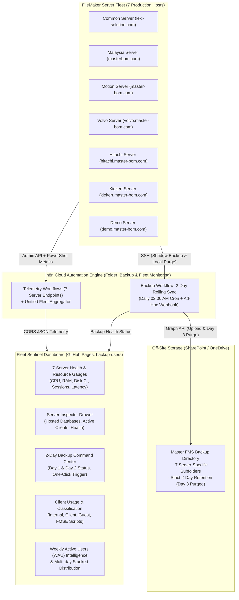

# FMS Fleet Sentinel & Backups (backup-users)

> **Enterprise-grade 7-Server FileMaker Fleet Monitoring, 2-Day Rolling Backup Pipeline & User Intelligence System**  
> Dedicated, isolated repository — operates independently without modifying or affecting `monitoring.lexisolution.com`.

---

## 🏛️ System Architecture



---

## 🖥️ Monitored Servers & Endpoints

| # | Server Name | Host Domain | Telemetry Webhook | OneDrive / SharePoint Folder ID |
|---|-------------|-------------|-------------------|---------------------------------|
| 1 | **Common** | `lexi-solution.com` | `/webhook/fms-common-dashboard` | `IgAf4mxRCPe0Tqe14VMj1utaAewVL3OfLzxnabFPyqsEORw` |
| 2 | **Malaysia** | `masterbom.com` | `/webhook/fms-malaysia-dashboard` | `IgBKo9ByA7fCSLN32fBqx-pWASZLNHpdYH6h3TeXnVLZlek` |
| 3 | **Motion** | `master-bom.com` | `/webhook/fms-motion-dashboard` | `IgDecuIeSKRJRrVcbDUN_Ae3AaL1u2f144I6Ib_eyQ56uPc` |
| 4 | **Volvo** | `volvo.master-bom.com` | `/webhook/fms-volvo-dashboard` | `IgBCYiMoRMs5RoBObE5bgdKBARW0DYT46JNtxJcmtW0bzB0` |
| 5 | **Hitachi** | `hitachi.master-bom.com` | `/webhook/fms-live-dashboard` | `IgD4Fb6dQPpJSJBmt1gl6HlLAWdN7L6ku2iyNie7zP81Zv4` |
| 6 | **Kiekert** | `kiekert.master-bom.com` | `/webhook/fms-kiekert-dashboard` | `IgCBmqDR1ngVTKNASHrE87RjAbgaEFL1KDdTg4VncqnWlTc` |
| 7 | **Demo** | `demo.master-bom.com` | `/webhook/fms-demo-dashboard` | `IgB9mLTDJ2KlTojpiOfrbUPdATgDsMQjHGKQzFzMUnR0Af4` |

---

## ⚡ Core Capabilities

### 1. 2-Day Rolling Retention Backup Sync & Purge
- **Automated Schedule**: Runs every morning at **02:00 AM** across all 7 servers.
- **Local Shadow Backup**: Executes PowerShell command via SSH to trigger non-locking FMS shadow backup (`fmsadmin backup -y`).
- **Compression & Local Retention**: Archives files to `C:\FMS_Backups\YYYY-MM-DD.zip` and removes archives older than 2 days.
- **SharePoint / OneDrive Sync**: Uploads zip archives to the designated OneDrive folder via Microsoft Graph API.
- **Day 3 Automated Purge**: Graph API inspects folder children, filters archives older than 2 days, and issues HTTP `DELETE` to maintain a strict 2-day rolling window.
- **Ad-Hoc Manual Trigger**: Instant one-click execution from the dashboard via `POST /webhook/fms-fleet-backup-trigger`.

### 2. Deep Server Inspector Drawer (In-Dashboard)
- Clicking any server card opens the **Server Deep-Dive Drawer**:
  - **Live Gauges**: Real-time CPU, RAM, Disk (C:), Latency, Network I/O, Cache Hit %.
  - **Hosted Databases**: Full list of open databases, storage size in GB, connected user counts, and status.
  - **Connected Users**: Drill-down of every client session active on that host.

### 3. Smart User Classification & Session Durations
- Classifies users across all 7 servers:
  1. **Internal Users**: Matched against Lexi Solution staff email directory (80+ employees).
  2. **Client Users**: Customer and external production accounts.
  3. **Guest Users**: `[Guest]` accounts requiring security monitoring.
  4. **FMSE Server Scripts**: Background server schedules and PSoS (Perform Script on Server).
- **Session Duration Alerting**:
  - Highlights long-running server scripts (>15m, >60m).
  - Highlights idle user sessions (>2h, >4h).

### 4. TV Wallboard Mode & Theme Switcher
- **TV Mode**: Compact, full-viewport layout designed for 1080p / 4K NOC wall displays.
- **Auto-scroll**: Hands-free vertical scrolling through connected sessions.
- **Theme Switcher**: Instant Dark / Light mode toggle persisted in `localStorage`.

---

## 🚀 n8n Cloud Setup

### Method A: Automated Provisioning via Script
Run the automated provisioner using your n8n Cloud URL and API Key:
```bash
node setup-n8n.js https://your-instance.app.n8n.cloud n8n_api_key_xxxxxxxx
```
The script will:
1. Create a dedicated project folder named **`Backup & Fleet Monitoring`**.
2. Upload all workflows from the `./workflows` directory.
3. Automatically link and activate them.

### Method B: Manual Import in n8n Canvas
1. In n8n Cloud, click **Workflows** → **New Workflow**.
2. Click the top-right menu (three dots) → **Import from File**.
3. Select the JSON files inside the `workflows/` directory:
   - `FMS_Fleet_2Day_Backup_OneDrive_Sync.json`
   - `FMS_Fleet_Telemetry_Aggregator.json`
   - Individual server telemetry workflows (`FMS_Telemetry_*.json`)

---

## 🌐 GitHub Pages Deployment

The repository includes a GitHub Actions workflow (`.github/workflows/deploy.yml`):
1. In your GitHub repository settings:
   - Go to **Settings** → **Pages**.
   - Under **Build and deployment**, select **Source: GitHub Actions**.
2. Every push to the `main` branch will automatically deploy the live dashboard to:
   ```
   https://devteam77-git.github.io/backup-users/
   ```
   *(Or bind to a custom domain such as `fleet.lexisolution.com`)*.

---

## 🔒 Production Safety Guarantee
- **Zero Impact on Production**: This repository and workflow structure is completely isolated.
- The existing production site `monitoring.lexisolution.com` remains 100% untouched and unchanged.
